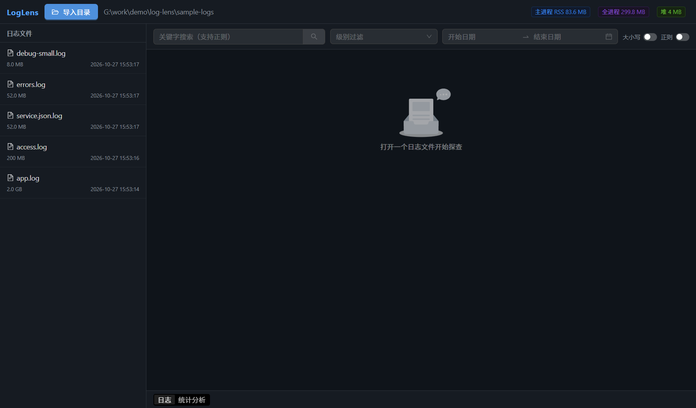
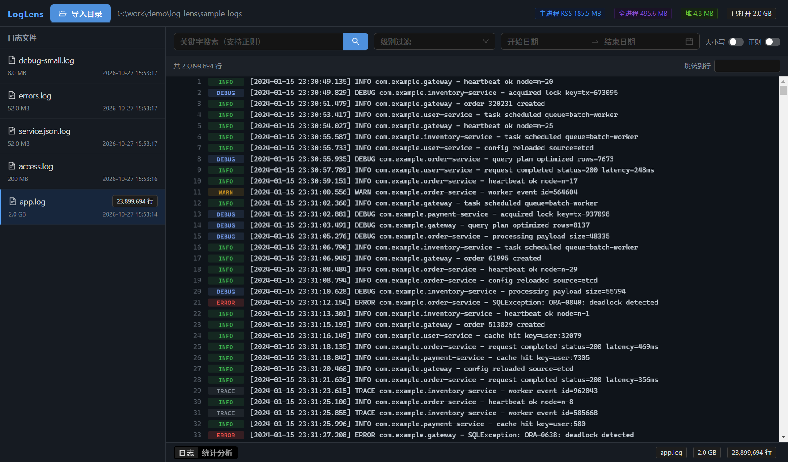
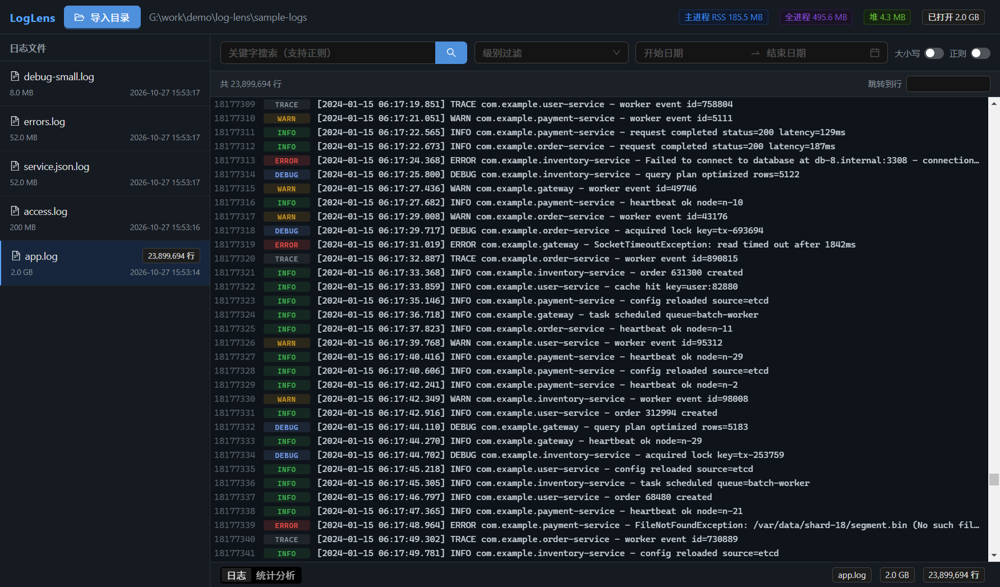
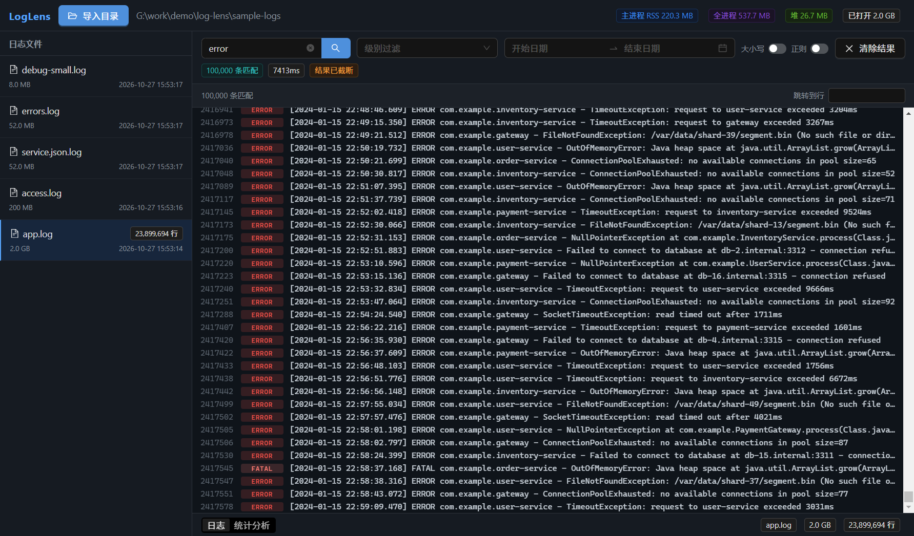
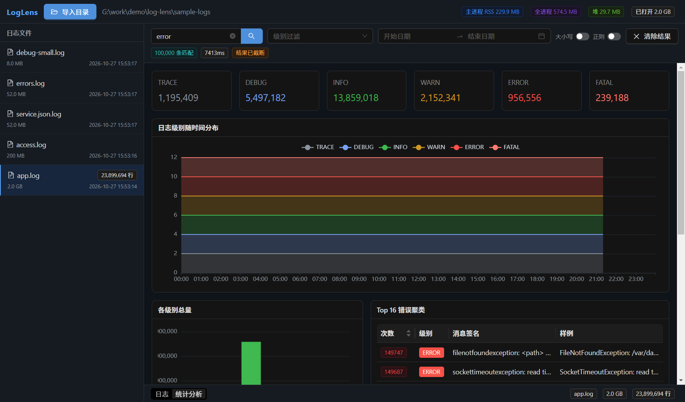

# LogLens — 本地日志探查桌面工具

一个帮助开发者在本地快速检索与分析海量日志文件的桌面客户端。**2GB 日志文件可秒级索引、流畅滚动、毫秒级检索，全程不把文件载入内存。**

基于 **Electron + React 18 + TypeScript** 构建，所有重型 I/O 在主进程（Node.js）完成，渲染进程只负责展示。

## ✨ 核心功能

- **目录导入与文件列表** — 展示文件名、大小、修改时间、解析出的日志条数
- **大文件支持** — 2GB 文件流式读取 + 行偏移索引，内存占用与文件大小解耦，UI 不卡死
- **检索与过滤** — 关键字（支持正则）、按级别 / 时间范围过滤，带进度反馈与可取消
- **统计分析视图** — 日志级别随时间分布折线/面积图、各级别总量、Top N 错误信息聚类

## 🖼️ 运行截图

| 导入目录 | 打开 2GB 文件 |
| --- | --- |
|  |  |

| 滚动到第 1817 万行 | 关键字搜索 |
| --- | --- |
|  |  |

| 统计分析 |
| --- |
|  |

## 📊 内存占用实测（2GB / 23,899,694 行文件）

完整数据见 [docs/memory-usage.json](docs/memory-usage.json)。

| 阶段 | 主进程 RSS | 全进程 | 渲染进程 JS 堆 |
| --- | --- | --- | --- |
| 导入目录 | 91 MB | 361 MB | 20.7 MB |
| 打开 2GB（构建索引） | 194 MB | 509 MB | 20.7 MB |
| 滚动到第 1817 万行 | 204 MB | 519 MB | 20.7 MB |
| 关键字搜索 | 233 MB | 583 MB | 20.7 MB |
| 统计分析 | 240 MB | 639 MB | 20.7 MB |

**关键结论**：2GB 文件打开后主进程仅 ~200MB（其中约 95MB 是 2390 万行的偏移索引），渲染进程 JS 堆恒为 ~20.7MB——**文件内容从未被整体载入内存**。

## 🚀 快速开始

```bash
# 1. 安装依赖
npm install

# 2. 生成样例日志（默认含 2GB 主文件，可用环境变量调小）
npm run gen:logs
#   LOG_MAIN_MB=64 npm run gen:logs   # 快速小规模样例

# 3. 启动应用（开发模式）
npm run dev

# 4. （可选）自动截图 + 内存采集
npm run capture
```

## 🛠️ 技术栈

- **桌面壳**：Electron 33
- **前端**：React 18 + TypeScript + Ant Design 5
- **图表**：Apache ECharts 5
- **构建**：electron-vite（Vite 5）

## 🏗️ 架构概览

```
┌─────────────────────────────────────────────────────┐
│  Renderer (React)                                    │
│  文件列表 · 日志查看器(虚拟滚动) · 搜索栏 · 统计图表      │
└──────────────▲───────────────────────────────────────┘
               │ IPC (contextBridge / window.loglens)
┌──────────────┴───────────────────────────────────────┐
│  Main (Node.js)                                      │
│  indexer 流式行偏移索引  ·  reader 按需取行              │
│  searcher 流式搜索      ·  stats 单遍统计               │
│  进度事件 / 取消信号                                    │
└──────────────────────────────────────────────────────┘
```

详细设计见 [docs/technical-design.md](docs/technical-design.md)。

## 📚 文档

- [PRD 产品需求文档](docs/PRD.md)
- [技术设计文档](docs/technical-design.md)
- [问题解决记录](docs/problems-and-solutions.md)
- [AI 协作规则](docs/rules.md)
- [AI 协作 Skills](docs/skills.md)

## 目录结构

```
log-lens/
├── src/
│   ├── main/          # Electron 主进程：索引/读取/搜索/统计
│   ├── preload/       # contextBridge 暴露 window.loglens
│   ├── renderer/      # React UI
│   └── shared/        # 共享类型与 IPC 通道
├── scripts/
│   ├── generate-logs.mjs  # 多样式样例日志生成器
│   └── capture.mjs        # 截图 + 内存采集驱动
├── docs/              # 文档与截图
└── electron.vite.config.ts
```

## License

MIT
